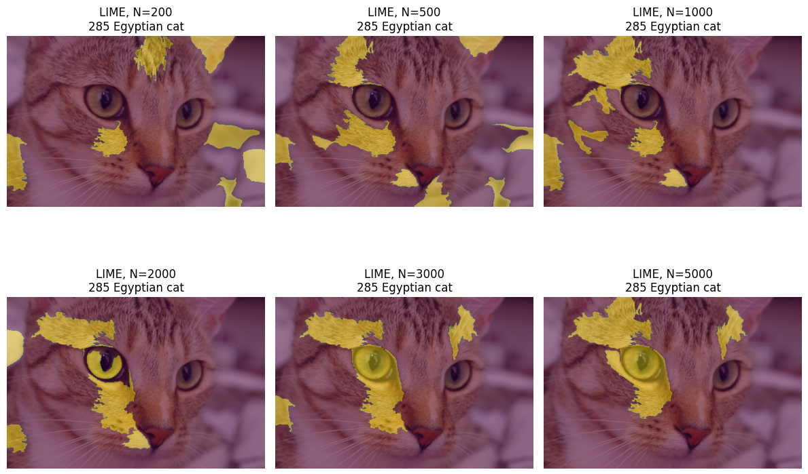
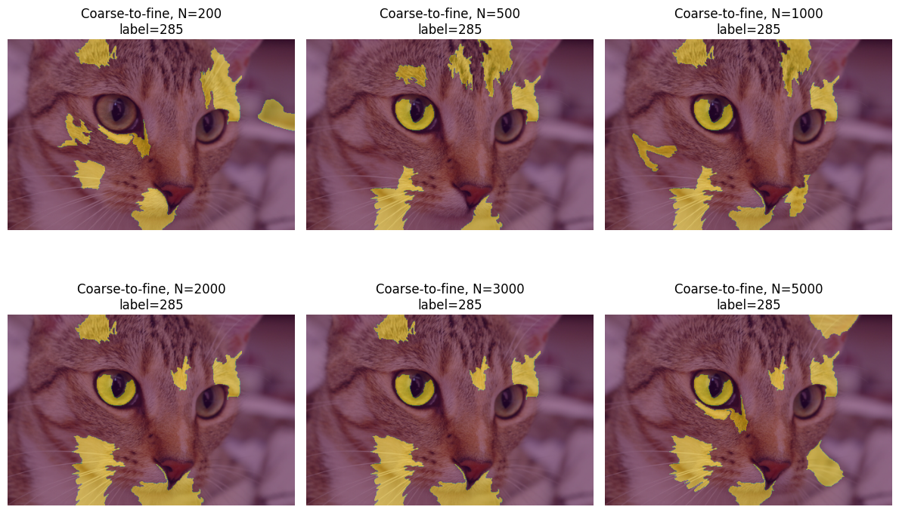

# Reliable LIME under Query Budget Constraints

This project studies the reliability of LIME image explanations under limited query budgets. While the original [LIME](https://arxiv.org/abs/1602.04938) paper mainly presents qualitative image examples, this project builds a quantitative evaluation pipeline for `lime_image` and investigates how explanation quality changes as the query budget decreases.  

Additionally, we propose a coarse-to-fine budget allocation strategy to improve explanation effectiveness under limited query budgets. When the query budget is large enough, our method may perform similarly to vanilla LIME. However, under smaller budgets, our method can identify meaningful image regions earlier, making LIME more practical for real-world settings where model queries may be costly or limited.  

## Qualitative Example  
Based on human visual prior knowledge, the eye and facial regions are semantically meaningful cues for recognizing cats. In the vanilla LIME result, the explanation starts to clearly highlight the eye region around a query budget of 2000. In contrast, our coarse-to-fine method highlights the eye region at a much lower budget, around 500 queries. This suggests that our method can identify meaningful image regions earlier under limited query budgets.  

**Vanilla LIME**  
  
**Coarse-to-Fine LIME**


## Environment setup
This project was developed and tested on **Windows 11** and  **[Python 3.8.10](https://www.python.org/downloads/release/python-3810/)**.

| Package      | Version      |
| ------------ | ------------ |
| python       | 3.8.10       |
| numpy        | 1.24.4       |
| scipy        | 1.10.1       |
| scikit-learn | 1.0.2        |
| scikit-image | 0.21.0       |
| matplotlib   | 3.7.5        |
| PyTorch      | 2.2.2+cu121  |
| torchvision  | 0.17.2+cu121 |  

With the Python 3.8.10 virtual environment activated, install the required packages:

```powershell
python -m pip install --upgrade "pip<25.1"
python -m pip install -r requirements.txt
python -m pip install -e .
```

`pip<25.1` keeps pip compatible with Python 3.8. The requirements file includes the official PyTorch CUDA 12.1 package index so pip can find the pinned `torch==2.2.2+cu121` and `torchvision==0.17.2+cu121` builds.

**Note:** The `requirements.txt` file was generated from the original Windows development environment. Some platform-specific packages may not be required on other systems. The pinned CUDA builds require a compatible NVIDIA GPU and driver for GPU acceleration; see the official [PyTorch 2.2.2 installation instructions](https://pytorch.org/get-started/previous-versions/#v222) for other configurations.

## Project structure

```text
src/reliable_lime/
    lime_base.py          # Local surrogate fitting and feature selection
    lime_image.py         # Baseline LIME image explainer
    segmentation.py       # Segmentation wrappers and fixed SLIC segments
    coarse_to_fine.py     # Coarse-to-fine sampling and explanation
    classifier.py         # Pretrained ResNet18 adapter
    metrics.py            # Fidelity, stability, and deletion metrics
    experiments.py        # Single runs and repeated budget sweeps
    visualization.py      # Explanation overlays and comparison plots
scripts/run_experiments.py # Command-line experiment runner
notebooks/                # Method walkthrough and original experiment outputs
tests/                    # Metric checks and regression tests
results/                  # Published figures and tables
report/                   # Report and presentation material
```

`pyproject.toml` defines the installable package and its direct dependencies.
`requirements.txt` preserves the full pinned Windows development environment,
including the CUDA package index. The baseline implementation is adapted from
the original LIME project; its copyright and BSD license are retained in
`LICENSE.txt`. The coarse-to-fine method and evaluation workflow are separated
from the baseline implementation in the modules above.

## How to reproduce

Run commands from the repository root with the virtual environment activated.
For a quick comparison on the notebook's built-in cat image:

```powershell
python scripts/run_experiments.py --method both --budgets 200 500 --seeds 0 1
```

The runner uses pretrained ResNet18 and selects CUDA when available. Its first
run downloads the model weights if they are not already cached. Each run saves
per-seed metrics, summary tables in CSV and HTML, explanation figures, and
settings with package versions in a new directory under `results/runs/`.
These generated run directories are ignored by Git; the published figures and
tables already in `results/` are retained.
Stability requires at least two seeds; a single seed produces `NaN` for that metric.

The default experiment uses budgets `[200, 500, 1000, 2000, 3000, 5000]` and seeds
`0` through `9`, matching the notebook. To run it, use
`python scripts/run_experiments.py`. Use `--method vanilla` or
`--method coarse-to-fine` to select one method, `--device cpu` to use the CPU,
and `--no-plots` to skip the additional explanation runs used to draw figures.
See `python scripts/run_experiments.py --help` for all options.

For the method explanation and interactive examples, open
[`notebooks/coarse2fine_LIME.ipynb`](notebooks/coarse2fine_LIME.ipynb) and select
the project's `.venv` kernel. The notebook imports the package implementation.
Its saved outputs are retained from the original experiments; the source
reorganization did not regenerate the full experiment results. The technical
report and presentation material are in [`report/`](report/).

## Validation

```powershell
python -m unittest discover -s tests -v
```

The tests check metric calculations and compare extracted explanations against
reference outputs captured from the original notebook using a deterministic
synthetic classifier. They do not require model downloads or a GPU.

## Existing implementation limitations

This reorganization preserves the notebook's algorithms and parameter defaults.
The `queries` column reports the configured sampling budget, rather than a count
of every classifier prediction. At the experiment budgets, the current
coarse-to-fine sampler predicts `budget - 1` images and fits `budget - 2` rows.
Reference-label prediction, deletion evaluation, and plotting make additional
classifier calls. The command-line runner requires budgets of at least 20 for
the existing two-stage sampler.

The intended candidate enlargement in coarse-to-fine sampling is limited by
the number of features returned by the first-stage surrogate. Baseline debug
models used by the fidelity metric are retained only for the first explained
label; the evaluation workflow therefore explains one fixed reference label.
These behaviors are documented and preserved so the refactor can be compared
with the original implementation.

## Reference

1. Ribeiro M T, Singh S, Guestrin C. " Why should i trust you?" Explaining the predictions of any classifier[C]//Proceedings of the 22nd ACM SIGKDD international conference on knowledge discovery and data mining. 2016: 1135-1144.
2. Official LIME repository: https://github.com/marcotcr/lime
3. Reference implementation used in this project: https://github.com/marcotcr/lime/blob/master/lime/lime_image.py

## Authors

- Qihang Feng qfeng5@ualberta.ca
- Wonki Byun wonki@ualberta.ca
- Zixi Chai zchai3@ualberta.ca
